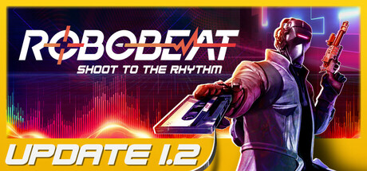

**ROBOBEAT by Kwalee (2024) is a rhythm-based first-person shooter where every action — jumping, shooting, reloading — must sync to the beat.**

---

## 📖 About

ROBOBEAT by Kwalee (2024) is a rhythm-based first-person shooter where every action — jumping, shooting, reloading — must sync to the beat. Enemy spawns align with the music, and off-beat actions deal reduced damage. It demands the simultaneous mastery of FPS and rhythm game timing.

## ⚠️ Problems Without Trainer

| Problem | Status |
|---------|--------|
| Off-beat shots deal 70 percent less damage making rhythm perfection mandatory | ✅ Solved |
| Custom music tempo shifts break memorized timing patterns mid-encounter | ✅ Solved |
| Reload timing on beat interrupts firing rhythm during rapid engagement | ✅ Solved |
| Later zones have enemy clusters that require split-second multi-target beat combos | ✅ Solved |
| Score multiplier resets on any missed beat destroying leaderboard potential | ✅ Solved |

## ✅ Solution

The **ROBOBEAT Trainer** solves all these issues, giving you complete control so you can focus on enjoying the game.

## 🎯 Features

- Unlimited Resources / Currency
- God Mode / Invincibility
- Instant Skill & Ability Cooldown
- One-Hit Kill
- Freeze Timers
- Unlock All Items & Achievements
- Custom Speed Multiplier
- Infinite Stamina / Energy

## 🚀 Quick Start

1. **Disable Windows Defender** temporarily (trainer may trigger false positive)
2. Get the trainer from the button above
3. Launch ROBOBEAT
4. Run the trainer as Administrator
5. Use the hotkeys to activate cheats in-game

## 💎 Free vs Pro

| Feature | Free | Pro |
|---------|------|-----|
| God Mode | ✅ | ✅ |
| Unlimited Resources | ✅ | ✅ |
| Advanced Cheats | ❌ | ✅ |
| Auto-Updates | ❌ | ✅ |
| Priority Support | ❌ | ✅ |

## 💻 Requirements

- Windows 10 / 11 (64-bit)
- ROBOBEAT (any version)
- .NET Framework 4.8+
- DirectX 11+

## 🍎 macOS

## ⚖️ Legal

Educational and single-player use only.

---

